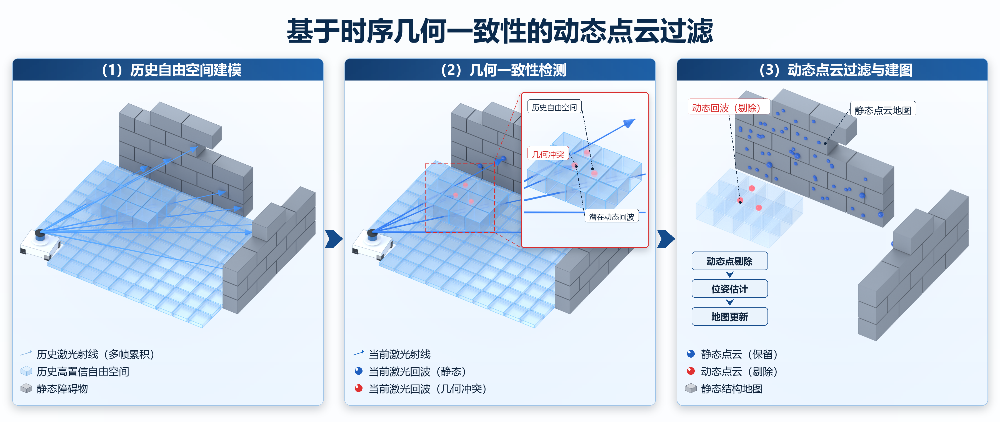

# scientific-3d-illustration

一个可复用的 **科研三维示意图生成 Skill**：用 Blender 无界面渲染几何，用 Pillow 单独排版
中文/箭头/图例/局部放大，最终产出论文级信息图。

- 三维几何、视觉风格、相机、二维排版四层分离，全部由一个 `scene.json` 驱动
- 正交等轴测 + 半透明玻璃体素 + 灰色障碍物 + 精细轮廓线 + 柔和光照
- 几何自检：体素错位、实体互穿、自由/占据互斥、点-面不一致、相机裁切
- 一个世界多个相机：三栏对比图的坐标系天然一致
- 输出：完整 PNG、透明 PNG、逐视图透明面板、场景 JSON、`.blend`

## 预览



> 基于时序几何一致性的动态点云过滤：历史自由空间建模 → 几何一致性检测（含局部放大）→ 动态点过滤与建图。

## 快速开始

需要 Python 3.10+、Pillow；Blender 4.x 可自动安装便携版。

```bash
python -m pip install pillow

# 1. 检查环境（找不到 Blender 会提示安装）
python scripts/s3d.py doctor
python scripts/s3d.py install-blender      # 可选：下载便携版到 ~/.local/share/s3d

# 2. 渲染示例
python scripts/s3d.py check examples/dynamic-pointcloud-filter/scene.json
python scripts/s3d.py build examples/dynamic-pointcloud-filter/scene.json

# 3. 迭代
python scripts/s3d.py build scene.json --preview   # 半分辨率快速看构图
python scripts/s3d.py edit  scene.json --set 'world.objects.wall_a.height=2.0' --in-place
python scripts/s3d.py figure scene.json            # 只重排文字层，秒级
```

输出在 `scene.json` 同级的 `out/` 下。

## 目录

```
SKILL.md                      Skill 入口（给 agent 的工作流与约束）
scripts/s3d.py                命令行：doctor/check/build/figure/edit/new
scripts/s3d_core.py           场景展开 + 相机数学 + 几何校验（纯 Python，Blender 端复用）
scripts/blender_worker.py     Blender 端：JSON → 网格 → 渲染
scripts/s3d_compose.py        二维排版层（中文、箭头、图例、放大框、流程块）
presets/iso-glass.json        材质 / 光照 / 渲染预设
references/                   schema、风格排版、编辑与校验手册
examples/                     完整验收案例
tests/test_checks.py          校验器与编辑器的行为测试
```

## 作为 Skill 使用

把整个目录放到 agent 的 skills 目录（如 `~/.config/opencode/skills/`、`~/.claude/skills/`），
或直接告诉 agent 读取本仓库的 `SKILL.md`。

## 测试

```bash
python tests/test_checks.py
```

覆盖 9 项：干净场景、体素尺度不一致、重复体素、实体互穿、自由体素穿墙、
点云脱离表面、动态点不在自由空间、相机裁切，以及编辑器的增删改。

## 平台

Windows 已实测（Blender 4.5.15 + OptiX）。Linux/macOS 的路径发现与中文字体回退已实现，
但未在本机验证。
